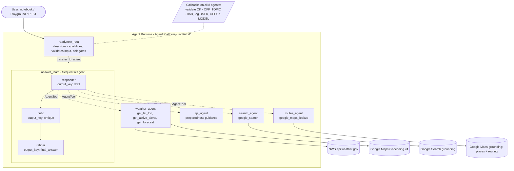

# Challenge 6: ReadyNow! — FEMA Emergency Preparedness Assistant

A multi-agent system built with the Google Agent Development Kit (ADK) that helps people during a
disaster: what is happening, where to go, how to get there, and how to stay safe. It combines the
agents, callbacks, workflow and deployment from Challenges 1-5 and runs on Agent Runtime (Agent Platform).

- Notebook: `challenge6_readynow.ipynb` (Colab Enterprise, fresh runtime)
- Architecture diagram: `architecture.svg` (also below)
- Package: `readynow/` (same code as the notebook's Sections 1-4, for `adk run` / `adk web`)

## Architecture

## Requirement map

| Requirement | Implementation |
|---|---|
| Root agent that describes what it can do and coordinates tasks and sub-agents | `readynow_root`: answers greetings and "what can you do?" itself with the capability list, hands every real request to `answer_team` |
| Agents for weather forecasting, searching the internet, routes via Google Maps, answering questions | `weather_agent` (NWS alerts + forecast, Geocoding), `search_agent` (built-in Google Search), `routes_agent` (Gemini Google Maps grounding with routing), `qa_agent` (FEMA / Ready.gov style guidance) |
| Sequential workflow that validates and refines responses | `answer_team = SequentialAgent[responder -> critic -> refiner]`; steps pass `draft`, `critique`, `final_answer` through session state with `output_key` and `{placeholders}` |
| Callbacks logging all user-agent interactions | `log_user_prompt` (before model) and `log_model_response` (after model) on all eight agents; lines land in the notebook locally and in Cloud Logging when deployed |
| User input validation | `moderate_user_prompt`: a few-shot Gemini 3.5 Flash-Lite classifier returns OK / OFF_TOPIC / BAD; OFF_TOPIC and BAD get a canned refusal before any model runs. Verdict cached per turn so multi-agent hand-offs classify once |
| Deploy to Agent Platform | `client.agent_engines.create(agent=AdkApp(root_agent), config=...)` with `env_vars` keeping Gemini on the `global` endpoint |
| Test code demonstrating functionality | Section 5: seven local checks (capabilities, weather, route, combined emergency, preparedness, off-topic refusal, malicious refusal). Section 7: four of them against the deployment |

## Design notes

- **Routes without an API key.** Student accounts cannot create Google Maps API keys, so routing uses
  Gemini's Google Maps grounding (`groundingTypes: places + routing`) through the Vertex AI REST
  endpoint with the project's own credentials. The deployed SDK's `google-genai` predates the typed
  field for routing, so the call is made over REST, which works on every version.
- **Why AgentTools inside the research step.** One emergency question usually needs alerts, news and a
  route together. Holding the specialists as tools lets the responder combine them in a single draft; the
  built-in Google Search tool stays alone in its agent as ADK requires.
- **Multi-agent callbacks.** Callbacks read the user's real message from `callback_context.user_content`
  rather than the last request message, because ADK injects notes about other agents' actions into the
  request; classifying those produced false refusals in Challenge 3 until this was fixed.
- **ADK version.** `google-cloud-aiplatform[agent_engines,adk]` pins ADK 1.14.x in the container, so the
  code uses only the 1.x API surface and was verified under both 1.14.1 and 2.11.
